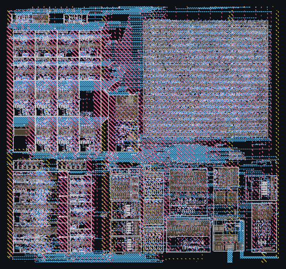

 

# Analog Neuron Test Bench

**A mixed-signal neuromorphic test chip for Tiny Tapeout TTGF26c** (GlobalFoundries GF180MCU-D, 3.3 V, analog 1 × 2 tile).

The chip puts 16 analog spiking neurons, a bit-exact digital LIF reference neuron, a programmable bias generator and a
buffered membrane-voltage readout on one 346 × 325 µm tile. Its purpose is to measure what simulation cannot predict
well — device mismatch, drift, leakage, noise, real parasitics and temperature — and to quantify how much
per-neuron configurability is worth in silicon area and accuracy.



*Full-chip layout (device and routing layers). A labelled version is in
[`docs/images/layout_blocks.png`](docs/images/layout_blocks.png); a high-resolution render is in
[`docs/images/layout_hd.png`](docs/images/layout_hd.png). Renders with every section, neuron slot and R2 block
(bay, E1, E2, E3) labelled are in [`docs/images/renders/`](docs/images/renders/)
([`chip_labeled.svg`](docs/images/renders/chip_labeled.svg), [`array_labeled.svg`](docs/images/renders/array_labeled.svg),
[`b1_labeled.svg`](docs/images/renders/b1_labeled.svg)).*

## Highlights

- **14 LIF neurons and a calibration reference channel in a 4 × 4 array**, arranged as a Latin square so die
  gradients can be separated from random mismatch. Four configurability levels are compared side by side:
  - **S**: shared biases only;
  - **F**: leak set by transistor geometry (τ_F = 2 τ_S);
  - **H**: shared biases plus a 4-bit per-neuron threshold trim;
  - **P**: threshold trim plus a 4-bit per-neuron leak-τ trim.
- **Single-instance variants:** a comparator-based LIF (with its own threshold trim), 50 fF and ~740 fF membrane
  variants, and a reference channel for calibrating the resting potential.
- **Adaptive exponential (AdEx) neuron** with a programmable adaptation current.
- **Dendritic neuron (D1):** a soma plus two subunits with an all-or-none plateau nonlinearity. Topology is selectable
  (star or chain), and clustered vs distributed input can be compared.
- **Digital LIF reference:** a 12-bit bit-serial LIF that implements the software reference model exactly.
- **Speed set by one input:** the reference current on `ua[0]` scales every time constant together. The design supports
  S = 10–1000× biological real time.
- **Off-chip sequencing:** the on-chip logic holds only configuration latches, the probe decoder and the digital LIF.
  Spike timing, counting and stimulus sequencing run on the Tiny Tapeout demo board's RP2040/RP2350.

## Architecture

| Block | Size (µm) | Function |
|---|---|---|
| Neuron array | 112 × 174 | 4 × 4 slots of 28 × 43.5 µm; each slot is a LIF neuron (200 fF membrane, leak OTA, refractory period, two synapses, hold switch, reset, probe follower). The comparator neuron uses a double-height slot. |
| P-group τ trims | 2 × (37 × 12) | Scale the P neurons' leak current to (8 + c)/16 of the S neurons' (4-bit code c). |
| AdEx | 38 × 73 | Adaptive exponential neuron. |
| D1 dendrite | 70 × 104 | Soma plus two dendritic subunits, with plateau detectors and two threshold trims. |
| B1 bias generator | 265 × 115 | Reference-current input and internal reference; eight 5-bit DACs (five current, three voltage via V-to-I) and a 6-bit threshold DAC. |
| R1 readout | 40 × 40 | 400 µA source-follower pad driver for `ua[1]`, plus the reset-voltage and detector-rail buffers. |
| Control block | 166 × 166 | Synthesized digital macro: 3-wire configuration port, write-only latches, probe decoder, digital LIF. |

The datasheet ([`docs/info.md`](docs/info.md)) has the pinout, register summary, bring-up procedure and firmware rules.
The full configuration map is in [`docs/regmap.md`](docs/regmap.md).

## Verification status

| Check | Result |
|---|---|
| Full-chip LVS (netgen; analog blocks hierarchical, control macro at gate level) | Circuits match uniquely |
| DRC: KLayout gf180mcuD deck, antenna, Magic `drc(full)` | 0 violations each |
| Tiny Tapeout precheck (run locally) | All checks pass |
| Control-block RTL (cocotb) | 14 / 14 tests pass |
| Analog blocks | Schematic simulation at 5 process corners × 0 / 27 / 85 °C; Monte Carlo mismatch; post-layout (PEX) firing-rate checks |

Post-layout firing rates come out at 0.8–0.9× schematic because of wiring capacitance. Per-die calibration through the
bias DACs absorbs this.

## Repository layout

| Path | Contents |
|---|---|
| `info.yaml`, `src/project.v`, `docs/info.md` | Tiny Tapeout project description, top-level Verilog stub and datasheet |
| `gds/`, `lef/`, `mag/` | Final top-level layout (GDS, LEF abstract, Magic database) |
| `cells/` | SPICE netlists of every analog cell, with design notes per block |
| `layout/` | Scripted layout generators and verification flows per block (`slot`, `bias`, `dendrite`, `readout`, `tier2` for AdEx) and the top-level assembly (`top`) |
| `floorplan/` | Floorplan definition and geometry checks (`floorplan.py`) |
| `rtl/`, `macros/` | Control-block RTL and its hardened macro (LibreLane) |
| `test/` | cocotb testbenches for the control block |
| `sim/` | ngspice testbenches, PDK characterisation decks and results |
| `model/` | Numerical reference models (LIF, AdEx, compartments) |
| `scripts/` | Container wrapper, precheck runner and layout renderer |
| `docs/` | Datasheet, register map, design plan and engineering notes |

## Building and checking

All EDA tools run in the pinned `hpretl/iic-osic-tools:2026.08` container. With Docker running, from Git Bash at the
repository root:

```bash
# Assemble the full chip: prepare blocks, route, assemble, extract, LVS
scripts/eda.sh "bash layout/top/build.sh"

# Full-chip DRC (KLayout gf180mcuD deck + antenna, Magic)
scripts/eda.sh "bash layout/top/drc.sh"

# Tiny Tapeout precheck on gds/
scripts/eda.sh "bash scripts/precheck.sh"

# Control-block tests
scripts/eda.sh "bash test/run_tests.sh"

# Render the layout images in docs/images/
scripts/eda.sh "klayout -b -r scripts/render_layout.py"
```

Each block under `layout/` has its own `build.sh` and README describing its flow and status.

## Documentation

| Document | Contents |
|---|---|
| [Datasheet](docs/info.md) | How it works, pinout, register summary, bring-up and test procedure |
| [Register map](docs/regmap.md) | Configuration protocol, addresses and bit packing |
| [Design plan](docs/08%20Updated%20Plan.md) | Frozen design: neuron complement, bias generator, control block, floorplan, speed envelope |
| [Floorplan](docs/06%20Floorplan.md) | Floorplan rationale and block placement |
| [Hardwiring experiment](docs/09%20Hardwiring%20Experiment.md) | Measurement protocol and area accounting for fixed vs configurable neurons |
| [Timeline](docs/10%20Timeline.md) | Tapeout gates and progress |
| [Research notes](docs/research/) | Bias generator, area estimates and speed limits |

## License

Apache 2.0. See [LICENSE](LICENSE).
