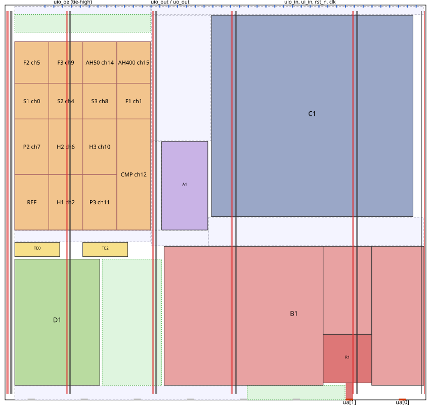

# Floorplan: analog 1×2 tile (2026-11-17)

The source of truth is `floorplan/floorplan.py`. It holds every box, stripe, channel and the neuron-array slot map, checks the geometry, and draws `docs/floorplan.svg`.
Run `py -3 floorplan/floorplan.py` after any change. All units are µm, with the origin at the tile's lower-left corner.

## 1. Layout

The tile is 346.64 × 325.36 µm. The TT digital pins run along the top edge; the analog pins are on the bottom edge, with ua[0] at x = 327 and ua[1] at x = 284.

| Block | Box (x0, y0 – x1, y1) | Area | Need (est.) | Margin |
|---|---|---|---|---|
| C1 control macro (rev C, hardened) | 132, 134 – 314, 316 | 33.1k | 33.1k | fixed |
| NA neuron array, 4 × 4 slots | 8, 136 – 120, 310 | 19.5k | 19.5k (S slot laid out) | 0 % |
| D1 dendrite | 132, 14 – 194.5, 118 | 6.5k | ~6k | +8 % |
| B1 bias + R1 pad driver + Vreset buffer | 205, 14 – 336, 118 | 13.6k | ~12.4k | +10 % |
| T2 Tier-2 zone (A1 AdEx ×2, S1 SC dendrite) | 8, 14 – 120, 104 | 10.1k | ~10k | +1 % |
| TE leak-τ trims for the 3 P slots | 8, 106 – 120, 118 | 1.3k | ~0.6k | +124 % |

Blocks take 84.2k µm² (75 %). The other 28.6k is routing channels, power stripes and guard gaps.

**Why it's arranged this way:**
- **Macro at the top, under the TT pins.** The digital pins drop straight into its north edge.
- **x = 132 is chosen for the power strap.** The macro's second internal strap pair then lands at x ≈ 198. That pair is extended full height and becomes the boundary between D1 and B1+R1. Sliding the macro ±10 µm moves that boundary if B1's real area differs.
- **Neuron array west of the macro.** It needs ~100 static control wires (spikes, probe one-hot, stimulus, trims). These come straight off the macro's west edge with no routing channel. In the first attempt, with the array at the bottom-left, they needed a ~70 µm channel.
- **B1+R1 bottom-right**, over both analog pins: ua[0] feeds the bias master and ua[1] is the probe output. B1's DAC codes come straight down from the macro's south edge.

## 2. Routing channels

| Channel | Box | Carries |
|---|---|---|
| CH_BOT | y 2–12, full width | ua[0]/ua[1] entry; bias lines to D1 and T2 |
| CH_MID | y 120–132, full width | bias lines B1 → NA (west, then up into the array's bottom edge); probe bus `abus` NA → pad driver; τ-trim bits from the macro south edge west to TE, and the 3 trimmed leak-bias lines from TE up into the array's columns; DAC codes from the macro south edge down into B1; sc_clk to T2 |
| CH_TOP | y 317–324 | jogs from the TT pins to the macro's north-edge pins (24 signals) |
| CH_E | x 315–336, y 134–316 | rst_n, clk from their tile pins into the macro's east edge |

- **Layers:** horizontal runs use Metal3, vertical runs Metal2. Metal4 is power only.
- **Probe bus:** about 250 µm long. Its estimated ~25 fF plus 16 switch junctions is within the 50 fF used in the readout settling simulation.
- **CH_TOP is the tightest channel** (about 6 Metal3 tracks). If the jogs don't fit, the fallback is a DEF template for the macro that puts its north pins directly under the tile pins.

## 3. Power

All stripes are vertical Metal4, from y = 5 to 320.36, as `mag/init_project.tcl` draws them.

| Pair (VDPWR / VGND x) | Width | Feeds |
|---|---|---|
| 1 / 4 (template) | 2 | NA, T2 |
| 122.5 / 125.5 | 2 | NA east side, D1 west side |
| 197.9 / 201.2 (the macro's own strap pair 2, extended) | 1.6 | macro, D1, B1+R1 |
| 338 / 341 | 2 | B1+R1, CH_E |

The macro's other three strap pairs stay internal; its Metal1 rails tie them together.

**There is no separate analog supply.** The answer is a measurement protocol, not more silicon:
- **Clock-off measurements.** Rev C's config latches, spike pins and stimulus pass-through all work with `clk` stopped. Any measurement of analog neurons that isn't using the digital LIF or the switched-capacitor dendrite should run with clk held low, so the digital is quiet apart from SCK during configuration writes.
- **Guard rings.** The neuron array and B1 get full guard rings and their own substrate taps.
- **Spacing.** At least 10 µm of space separates them from the macro, including the stripe gap.

## 4. Neuron array: slot map

There are 16 slots of 28 × 43.5 µm (1,218 µm² each). Each slot holds one LIF with its 200 fF membrane (except where noted), leak, detector, refractory, in-cell probe follower and switch, and up to two trim cells.

The groups are placed as a 4 × 4 Latin square: each group has one member in each of 3 rows and 3 columns, which exposes any gradient across the array (EXP-47). The square's diagonal holds the single cells.

| Row (top to bottom) | col 0 | col 1 | col 2 | col 3 |
|---|---|---|---|---|
| 3 | S3 ch8 | F3 ch9 | P3 ch11 | **AH800** ch15 |
| 2 | P2 ch7 | H3 ch10 | **AH50** ch14 | F2 ch5 |
| 1 | H2 ch6 | **CMP** ch12 | F1 ch1 | S2 ch4 |
| 0 | **REF** | S1 ch0 | H1 ch2 | P1 ch3 |

**Groups** (all axon-hillock LIF, 200 fF, 3 neurons each):
- **F (fixed geometry):** parameters set by device sizing.
- **S (shared bias):** parameters from the shared bias lines.
- **H (hybrid):** S plus a per-neuron threshold trim.
- **P (programmable):** gap trim plus a leak-τ trim (decided 2026-11-18). It can be cut if area runs short (§4).

The trim choice follows the week-1 Monte Carlo: threshold explains 62–88 % of rate variance and leak offset ~25 %; leak conductance explains only 3–5 %, so it gets no trim.

**Single cells:**
- **CMP:** comparator LIF, 200 fF.
- **AH50 and AH800:** axon-hillock LIF at 50 fF and 800 fF, the capacitance spread.
- **REF:** a probe-calibration follower driven by the EL voltage DAC. It has no spike output.

**Spike channels (spk_in index = pin):**
- uo[0..7] carry ch0–7 and uio[0..5] carry ch8–13. ch13 is the D1 soma.
- ch14 (AH50) and ch15 (AH800) appear on uio[6]/[7] only when OUT_MUX = 1, in place of the digital LIF spike and the config echo.
- ch0 is S1, so digital LIF source 3 ("analog neuron 0") is a shared-group neuron.

**Trim nibbles (NTRIM = 16; 12 used):**

| Nibble | Trim | Where the trim cell sits |
|---|---|---|
| 0 | H1 threshold | in slot |
| 1 | P1 threshold | in slot |
| 2 | H2 threshold | in slot |
| 3 | P2 threshold | in slot |
| 4 | H3 threshold | in slot |
| 5 | P3 threshold | in slot |
| 6 | CMP threshold | in slot |
| 7 | D1 subunit d1 plateau threshold | in D1 |
| 8 | D1 subunit d2 plateau threshold | in D1 |
| 9–12 | spare | — |
| 13, 14, 15 | P1, P2, P3 leak τ | TE strip below the array |

**P's second knob is a leak-τ trim, outside the array** (decided 2026-11-18).
- **Why not EL:** the slot track found the in-slot gap trim already does exactly what an EL trim would. It shifts rest relative to threshold and reset, so an EL trim would only duplicate it.
- **What it changes:** the τ trim sets each P neuron's leak conductance, roughly 0.7–2× nominal τ. That is an independent per-neuron parameter.
- **Expected effect:** as mismatch correction it is expected to help little, since leak g explains 3–5 % of rate variance. The point is per-neuron programmability.
- **Why outside the array:** a laid-out slot only has room for one trim cell.
- **Where:** three `trim4_n` current trims (B1's verified cell) plus diode masters sit in the **TE strip** (8, 106 – 120, 118), directly under the array.
- **How the bias gets up:** each P slot is in a different column (P2 col 0, P3 col 2, P1 col 3). Each master's gate voltage runs up that column on an extra full-height Metal2 track, `aux`, which every slot carries as a feed-through. The P slot (`slot_ah_p`) takes its leak-OTA tail gate from `aux` instead of the shared `vbn_leak`.
- **Cut path:** if area runs short, a single generator flag turns the P slots back into H slots and removes the TE strip. That gives its 1.3k µm² back to T2. The group then becomes 6 hybrid neurons.
- **Wiring the bits:** their nibbles are the last three, so the 12 bits are contiguous and leave the macro's south edge (§5).
- **Spares:** the 4 spare nibbles could become AH50/AH800 threshold trims. Alternatively, NTRIM could be cut to save latches, which only matters if the macro is ever re-sized.

**Probe:**
- **Selection:** PROBE_SEL k picks spike channel k's slot (ch13 = D1).
- **PROBE_SUB values:** 0 = membrane, 1 = secondary node (refractory node for LIFs, adaptation for A1), 2 = dendrite compartment (D1 subunits), 3 = the REF follower whatever SEL is.
- **Decoding:** each slot gates its taps with one-hot AND the SUB decode, a few transistors per slot.

## 5. Macro pin edges (`rtl/librelane/mkpins.py` → `pin_order.cfg`)

| Edge | Pins | Faces |
|---|---|---|
| N | uio_out, uo_out, ui_in (24), in tile pin order | TT pins, through CH_TOP |
| E | rst_n, clk, plus uio_oe/uio_in parked unrouted | CH_E |
| W | spk_in (16), probe one-hot (16), rt_out (4), in-array trims (52) = 88 | NA |
| S | sc_clk, τ trims (12), misc analog bits (12), bias DAC codes (66) = 91 | CH_MID → TE, D1, B1, T2 |

- **Verified in hardening.** Re-hardened with this pin order in `rtl/librelane/runs/fp_pins/` at the same 182 × 182 µm box:
  - every pin is on its intended edge, with clk/rst_n at the top of the east edge;
  - DRC (route, Magic, KLayout), LVS and antenna are clean;
  - ss setup slack is +1.86 ns at 25 ns (re-run after moving the P-slot trim bits to the south edge);
  - the power straps are unchanged (VDD at local x 15.92/65.92/115.92/165.92).

  This run replaces `s182_d86_cts` as the macro to integrate.
- **uio_oe** is driven at top level by tie-high cells next to its tile pins (all 1, as rev C drives it). The macro's uio_oe outputs are left unconnected.
- **uio_in** is unused.

## 6. Changes from the design plan (04 §2)

- **Neuron count is set by the 16 spike pins.** The plan's N1 ×8 + N2 ×2 + G1 4×4 became 12 group neurons + CMP + AH50 + AH800 + D1 soma.
  - 50 fF comparator variant dropped: the Monte Carlo showed 50 fF ≈ 200 fF for static mismatch.
  - Separate probed/unprobed pairs (P1) dropped: every slot has a follower, so loading is measured as "probe enabled vs disabled" on the same neuron.
- **Tier-2 budget is 10.1k µm², not ~25k.** That is A1 + S1 with no margin. W1 and D2 (second dendrite) no longer fit.
- **Hybrid group's trim is a threshold trim, not a gain trim.** This needs a new voltage-offset trim cell. B1's existing `trim4` current trim is used for nothing in the array as now planned.

## 7. Risks to retire at G2 (Nov 22)

1. **Slot size.** *Update 2026-11-17:* the S slot is laid out at exactly 28 × 43.5 µm (`layout/slot/`). It is Magic and KLayout DRC clean and LVS-matched, and it reserves room for one 170 µm² trim and the synapse. It is routing-bound: routing takes 39 % of the slot, so the area is used up. The P slot (`slot_ah_p`) is also laid out, with an extra `aux` column line at x = 21.35, in the same box. It too is DRC clean and LVS-matched. Its second (leak-τ) trim lives outside the array (§4). Still open: AH800 needs a cap 4× larger. Original note: 1,218 µm² has to hold an axon-hillock LIF plus two trims (P slots) or an 800 fF cap (AH800, 200 µm² of cap alone). The first N1 layout settles this; NA has 22 % spare in the block.
2. **B1 area.** The 10.2k µm² estimate is routing-bound and unverified. The 10 % margin can be grown by sliding the macro west, at the cost of the neuron array's width.
3. **CH_TOP capacity** (§2).
4. **TT questions:** answered 2026-11-18 (`docs/07 TT Discord Answers.md`).
   - Power ports must be full height.
   - Tie-high cells on uio_oe are preferred.
   - The macro inside the tile is fine.

   New follow-ups:
   - Secondary ESD on ua[0].
   - Readout settling into a much larger board capacitance.
   - Rewrite the config after every enable.
   - Whether to move the analog section to VAPWR.
